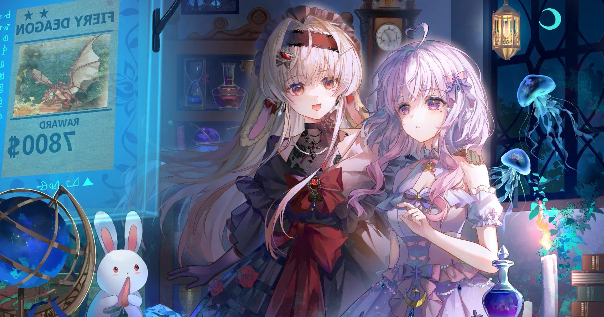

# dsh-jellyfish-theme

给 Deepseek Harness Web UI 用的**深海水母主题**插件：用一张水母插画作为整个界面的背景，并把配色改成生物荧光的深海色调（深海靛蓝底 + 青蓝强调色 + 藕紫辅助色）。浅色 / 深色两套调色板都做了适配。

> DSH bundle（`dsh.bundle.patch`）+ 动态客户端插件。主机侧只有一行空实现，全部效果在浏览器侧完成。



## 它做了什么

1. **重配色**：通过客户端 `ctx.theme.overrideTokens('jellyfish', …)` 覆盖 40 多个 `--dsw-alias-*` 别名 token（背景、卡片、菜单、边框、文字、品牌色、气泡、代码块等），亮/暗两套值都给全，所以切换外观模式不会出现"半套配色"。
2. **铺插画**：注入样式表把插画作为 `html` 与 `body` 的固定背景（`cover`，纵向锚点在 32% 处，避免 `cover` 在宽窗口下裁到原图下方那条暗色桌面），并把宿主外框、对话面板的不透明底色让开，使画面能从侧栏与面板之间透出来。
3. **保可读**：在插画之上叠一层纵向渐变作为"可读性遮罩"（上下重、中间轻），中间阅读栏再叠一层高不透明度的霜层，卡片 / 菜单 / 弹层仍保持接近不透明——正文对比度按计算仍在 7:1 以上。

## 安装

### 方式 A：本地目录（推荐）

```bash
# profile 目录下
pnpm add link:/path/to/dsh-jellyfish-theme
```

然后在 profile 的 `package.json` 里把它加进 bundle 列表：

```json
{
  "dsh": {
    "profile": {
      "bundles": ["@deepseek-ai/dsh-base", "@deepseek-ai/dsh-web-app", "@local/jellyfish-theme"]
    }
  }
}
```

如果你用 DSH 的插件管理器，直接"从目录安装"指向本仓库目录即可（等价于上面的步骤）。

### 方式 B：git 依赖

```bash
pnpm add github:ailixiya24865-alt/dsh-jellyfish-theme
```

`client.js` 已经构建好并提交进仓库，因此不需要额外构建步骤。

### 安装 / 更新后必须做的一步 ⚠️

**改完代码或更新版本后，仅重新安装是不够的。** 如果 bundle 的选中状态没有变化，宿主会判定"无变化"（`changed:false`）而**不重新应用**，浏览器会继续运行旧的 `client.js`。必须让它真正重新应用：

1. 在插件页把本 bundle **关掉再打开**（或重启 Web 服务）；
2. 然后**硬刷新**页面（`Ctrl+Shift+R`）。

判断是否跑在新代码上：插件描述末尾带构建号，例如 `(v1.0.9)`。

## 重新构建

`client.js` 是由 `client.tpl.js` 生成的（把插画转成 base64 内联进 `background-image`）：

```bash
node tools/build-client.mjs
```

脚本会：把 `assets/backdrop.jpg` 内联进模板、写入构建号、把 `package.json` 版本号 +1、并把版本号同步进两个 locale 描述。**请编辑 `client.tpl.js`，不要直接改 `client.js`。**

## 目录结构

| 路径 | 作用 |
| --- | --- |
| `package.json` | bundle 清单：`dsh.bundle.patch`、`dsh.client`、导出与 `files` |
| `cordis.patch.yml` | 向 loader 插入 `jellyfish-theme` 插件行 |
| `index.js` | 主机侧实现（当前为空，效果全在客户端） |
| `client.tpl.js` | **可编辑的客户端源码**（token 表、样式表、`apply`） |
| `client.js` | 构建产物，客户端加载器实际执行的文件 |
| `tools/build-client.mjs` | 构建脚本 |
| `locale/{en,zh}.json` | 插件页显示的标题与描述 |
| `assets/backdrop.jpg` | 背景插画（1680×885） |
| `icon.jpg` | 插件图标（由插画裁切） |
| `icon.svg` | 图标设计草稿（未在 `exports`/`files` 中，仅作素材保留） |

## 调参

想把画面调得更明显或更含蓄，改 `client.tpl.js` 里这几个变量（浅色与深色各一组），然后重新构建 + 重新应用：

| 变量 | 含义 |
| --- | --- |
| `--jellyfish-veil` / `-soft` / `-strong` | 遮罩在画面中部 / 上方 42% / 顶部与底部的压暗强度 |
| `--jellyfish-surface-strong` / `-soft` | 中间阅读栏霜层在上下端 / 中段的浓度，越小插画越清晰、文字对比度越低 |
| `--dsw-specific-sidebar-fill` | 侧栏底色透明度（token 表里） |
| `--dsw-alias-bg-base` | 全局底色的透明度（token 表里） |

## 实现要点（改代码前值得读）

选择器不依赖 CSS Module 的哈希类名，而是锚在插槽属性上。运行时的真实结构是：

```
#root > div[data-slot="root"]            ← 插槽包装层，display: contents
  └ div.<frame>                          ← 外框（不是 #root 的第一个子元素！）
      ├ div.<sidebarCol>   > div[data-slot="sidebar"]
      ├ div.<centerCol>    > div[data-slot="main"]
      │                      > div[data-slot="main.conversation"] > div.<conversationRoot>
      ├ div.<rightbarCol>
      ├ div[data-shell-bottom]
      └ div[data-shell-overlay]
```

三条关键规则：

- 外框默认会以 `--dsw-alias-bg-base` 铺满整个窗口（Windows 下还有更高优先级的 `[data-windows-titlebar] .frame`），必须显式清掉它的底色，插画才可能透出来；
- 中间列的霜层用 `div:where(:nth-child(2), :has(> [data-slot="main"]))` 双路匹配：`:where()` 是宽容语法，即使 `:has()` 不可用，位置分支仍然命中；
- 插画同时挂在 `html` 与 `body` 上：根元素的背景画在整个文档的画布层，任何后代都盖不住它；`body` 那份是防止某些样式表把根元素背景覆盖掉。

## 许可

- **代码**（`*.js`、`*.mjs`、`*.json`、`*.yml`、`*.md`）：MIT，见 [LICENSE](LICENSE)。
- **插画**（`assets/backdrop.jpg`、`icon.jpg`，以及内联进 `client.js` 的那份 base64）：**不在 MIT 许可范围内**。它是本仓库作者提供的素材，仅随本插件一起分发；如果你不是权利人，请不要再次分发。想以纯代码方式使用本插件，可删除插画并把 `client.tpl.js` 中的背景层换成自己的素材。

---

## English summary

A Deep-Sea Jellyfish theme for the Deepseek Harness Web UI: bioluminescent abyss
palette (light and dark) plus an illustration as the shell backdrop, with a
gradient readability veil and a frosted reading column.

- Host half is empty; everything happens in `client.js` (client plugin).
- Edit `client.tpl.js`, then run `node tools/build-client.mjs`.
- **After installing or rebuilding, the bundle must be re-applied** (toggle it off
  and on in the plugin list, or restart the web service) and the page
  hard-refreshed; otherwise the browser keeps running the previous `client.js`.
- Code is MIT. The bundled illustration is **not** covered by the MIT license.
